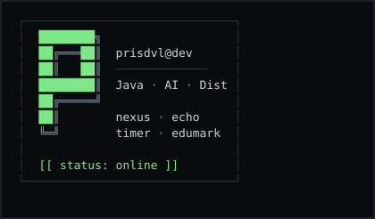
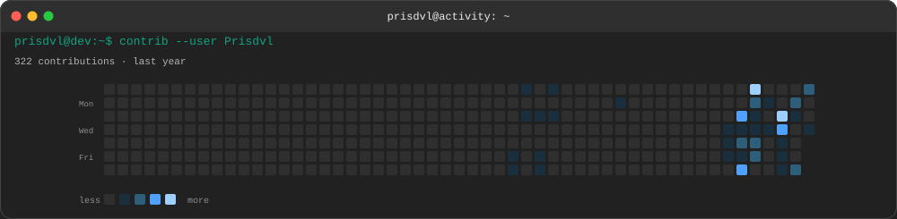
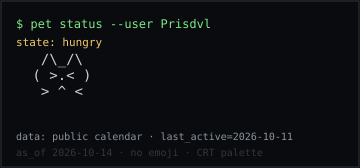

# Prisdvl

<p align="center">
  <picture>
    <source media="(prefers-reduced-motion: reduce)" srcset="assets/terminal-static-enhanced.svg">
    
  </picture>
</p>

<p align="center">
  <code>Java</code> · <code>Spring AI</code> · <code>RAG</code> · <code>Agent</code> · <code>Distributed Systems</code>
</p>

## Identity



## Selected Projects

Verified from public GitHub repositories (descriptions from each repo’s README or GitHub metadata). `sky-take-out` was **not** found as a public repo under this account and is omitted.

| Project | Stack (from GitHub languages) | Notes |
| --- | --- | --- |
| [prisdvl-nexus](https://github.com/Prisdvl/prisdvl-nexus) | Java, TypeScript, Vue | Personal knowledge base + Spring AI agent platform (RAG, hybrid retrieval, tool-calling agents). |
| [homework-grading-system](https://github.com/Prisdvl/homework-grading-system) | Python, Vue | K–12 homework grading API: FastAPI, OCR, Celery, DeepSeek-backed scoring. |
| [PrisTimer](https://github.com/Prisdvl/PrisTimer) | Rust, Vue, TypeScript | Tauri 2 focus timer with an anchor-based engine (liquid-glass UI). |
| [Kakuki](https://github.com/Prisdvl/Kakuki) | JavaScript, TypeScript, Python | Django + React + MySQL application. |

## Contribution activity

Terminal-styled heatmap from the public contributions calendar (`github.com/users/Prisdvl/contributions`). No fabricated counts.



<details>
<summary>Terminal pet</summary>



State rules (deterministic): recent activity → `happy`; 3–6 quiet days → `hungry`; 7+ quiet days or all-zero calendar → `sleeping`; missing data → `idle` (unknown, not zero).

</details>

## Local build

Requires **Node.js 22+**. Assets under `assets/` are generated; do not hand-edit SVGs.

```powershell
npm ci
npm run build:all
```

Individual targets:

```powershell
npm run build:crt
npm run build:profile
npm run generate:ascii
npm run generate:contribution
npm run generate:pet
```

CRT post-process validation (PowerShell):

```powershell
Select-String -Path assets/terminal-enhanced.svg -Pattern 'height="3"' -SimpleMatch
Select-String -Path assets/terminal-enhanced.svg -Pattern 'fill-opacity="0.05"' -SimpleMatch
Select-String -Path assets/terminal-enhanced.svg -Pattern 'stop-opacity="0.35"' -SimpleMatch
if (-not (Select-String -Path assets/terminal-static-enhanced.svg -Pattern 'scanline-overlay' -SimpleMatch)) {
  Write-Host 'OK: no animation class in static file'
}
```

Optional weekly refresh: `.github/workflows/refresh-profile.yml` (`workflow_dispatch` + schedule). It stages into a temp directory, validates XML, then replaces `assets/` and commits only when files change. Tokens are never logged.
