# CRT GitHub Profile

**English** | [简体中文](README.zh-CN.md)

> A configurable, locally generated CRT-style GitHub profile with reusable SVG output.

<p align="center">
  <picture>
    <source media="(prefers-reduced-motion: reduce)" srcset="assets/terminal-static-enhanced.svg">
    
  </picture>
</p>

[](https://nodejs.org/)
[](./LICENSE)
[](https://github.com/Prisdvl/crt-github-profile/actions/workflows/refresh-profile.yml)

This repository is both a working profile example and a reusable generator. Edit one JSON file, run one command, and get a terminal profile, ASCII portrait, projects card, contribution heatmap, and a ready-to-use Profile README — rendered locally on your machine, with no hosted service and no account required.

## Why CRT GitHub Profile

- **Config-driven.** `profile.config.json` is the single source of truth for identity, skills, projects, theme, and terminal content — no JavaScript edits for normal customization.
- **One command.** `npm run generate` validates the config, renders every SVG, and writes the Profile README.
- **Reusable output.** The generated README and its assets drop straight into your `<username>/<username>` repository.
- **Local-first.** GitHub access is used only for optional live contribution and activity data; failures fall back to cache or a clearly marked placeholder — never fabricated counts.
- **Motion-aware.** The animated terminal ships with a `prefers-reduced-motion` static variant, selected automatically.
- **Pinned toolchain.** The `svg-terminal` renderer is pinned in `devDependencies`; there is no remote build service.

## Quick Start

Prerequisites: **Node.js 22 or newer** (`node -v`) and npm. The first `npm install` needs npm registry access; after that, generation runs locally.

1. **Create your copy.** [Use this template](https://github.com/Prisdvl/crt-github-profile/generate) (recommended for a new profile) or [fork this repository](https://github.com/Prisdvl/crt-github-profile/fork). See [Template vs fork](#template-vs-fork).
2. **Edit [`profile.config.json`](./profile.config.json).** Set at least `username`, and replace the shipped identity, skills, projects, and `terminal` content with your own.
3. **Install and validate.**

   ```bash
   npm install
   npm run validate:config
   ```

4. **Generate.**

   ```bash
   npm run generate
   ```

5. **Publish.** Copy the generated files into your profile repository — see [Publish to your GitHub profile](#publish-to-your-github-profile).

## Template vs fork

- **Use this template** (recommended): creates an independent repository you own outright. You get the generator with a clean history; upstream changes do not affect you, and your profile is not tied to a fork network.
- **Fork**: creates a linked copy that can pull upstream updates. Choose this only if you want to track changes in this repository.

Either way, the steps after copying are identical.

## What the generator produces

`npm run generate` writes:

| Output | Description |
| --- | --- |
| `assets/terminal-enhanced.svg` | Animated CRT terminal: identity panel, ASCII portrait, skills, projects, and contribution sections in one window. |
| `assets/terminal-static-enhanced.svg` | Static variant for `prefers-reduced-motion`. |
| `assets/ascii-portrait.svg` | Standalone ASCII portrait card. |
| `assets/projects.svg` | Standalone projects card. |
| `assets/contribution.svg` | Terminal-styled contribution heatmap (only when `options.contributionHeatmap` is enabled). |
| `dist/PROFILE-README.md` | The Profile README to publish. |

The two standalone cards (`ascii-portrait.svg`, `projects.svg`) are conveniences; the Profile README does not reference them. Disabling an option (`animatedTerminal`, `contributionHeatmap`) skips that output and its references; previously generated files are left in place. The legacy `npm run build:all` entry remains a full compatibility build and can regenerate both optional outputs.

## Publish to your GitHub profile

1. If you do not have one yet, create a repository named exactly `<username>` (your GitHub handle), public, with a README — that is your profile repository.
2. Copy `dist/PROFILE-README.md` to the repository root as `README.md`.
3. Copy the assets it references, keeping the `assets/` folder next to it:
   - default (`options.readmeStyle: "svg-only"`): `assets/terminal-enhanced.svg` — or `assets/terminal-static-enhanced.svg` when `animatedTerminal` is `false`.
   - `options.readmeStyle: "full"`: additionally `assets/terminal-static-enhanced.svg`, plus `assets/contribution.svg` when the heatmap is enabled.
4. Commit and push that repository.

The root `README.md` of this repository is the project introduction. It is not overwritten by the generator.

Optional: open `preview-crt.html` in a browser to review every generated asset locally — including a narrow (~420px) rendering — before publishing.

## Keeping the profile up to date

The published profile is static: contribution data and the latest-commit line are baked into the SVGs at generation time. Two ways to refresh it.

### Option A — generator stays separate (default)

Regenerate locally and re-copy the changed files:

```bash
npm run generate
```

Then copy `dist/PROFILE-README.md` and the assets it references (the same list as [Publish to your GitHub profile](#publish-to-your-github-profile)) into your profile repository and commit. Only files whose content changed need re-copying.

### Option B — self-contained profile repository (automated)

Put the generator inside the profile repository so GitHub Actions can regenerate everything on a schedule and whenever you push a configuration edit. Everything the generator needs travels with the copy: `profile.config.json`, `terminal.yml`, `scripts/`, `templates/`, `assets/ascii-art.txt`, and `package.json` with `package-lock.json` (which pull the pinned `svg-terminal` via `npm ci`). No extra services, secrets, or runtime dependencies are required — public contribution data works without authentication, and the workflow uses the auto-provisioned `GITHUB_TOKEN` only for rate limits. Trade-off: the profile repository publicly contains the generator code.

1. Create your profile repository (named exactly `<username>`, public, **without** an initial README), then push a copy of this repository into it:

   ```bash
   git clone https://github.com/Prisdvl/crt-github-profile.git <username>
   cd <username>
   git remote set-url origin https://github.com/<username>/<username>.git
   git push -u origin main
   ```

2. Edit `profile.config.json` (at least `username`), then build and publish once:

   ```bash
   npm install
   npm run generate
   cp dist/PROFILE-README.md README.md
   git add -A
   git commit -m "Initial CRT profile"
   git push
   ```

3. Replace `.github/workflows/refresh-profile.yml` (copied from this repository, where it only refreshes the demo assets) with the following, so the profile itself is regenerated and published:

   ```yaml
   name: Refresh profile
   on:
     workflow_dispatch:
     push:
       branches: [main]
     schedule:
       - cron: "17 3 * * 1"
   permissions:
     contents: write
   jobs:
     refresh:
       runs-on: ubuntu-latest
       if: github.event_name != 'push' || github.actor != 'github-actions[bot]'
       steps:
         - uses: actions/checkout@v4
         - uses: actions/setup-node@v4
           with:
             node-version: "22"
             cache: npm
         - run: npm ci
         - run: npm run validate:config
         - name: Generate profile
           env:
             # Public contribution HTML works without auth; the token only
             # improves rate limits. Never echo the token.
             GITHUB_TOKEN: ${{ secrets.GITHUB_TOKEN }}
           run: npm run generate
         - run: cp dist/PROFILE-README.md README.md
         - name: Commit if changed
           run: |
             git config user.name "github-actions[bot]"
             git config user.email "41898282+github-actions[bot]@users.noreply.github.com"
             git add README.md assets/*.svg
             if git diff --cached --quiet; then
               echo "No changes"
               exit 0
             fi
             git commit -m "chore: refresh profile [skip ci]"
             git push
   ```

   The workflow regenerates the profile every Monday, after each configuration edit pushed to `main`, or on demand from the Actions tab (`workflow_dispatch`), then commits the updated `README.md` and SVG assets. The actor guard and `[skip ci]` keep the bot's own commits from re-triggering it. Delete the workflow file to stop automation — the manual Option A flow always works.

## Configuration

A compact example using existing fields — theme colors merge individually, while `skills` and `projects` replace the whole list:

```json
{
  "theme": { "accent": "#ff5500", "background": "#101820" },
  "skills": [{ "name": "Rust", "level": 65 }],
  "projects": [
    {
      "name": "your-project",
      "stack": "Rust / Tauri",
      "description": "A concise project description",
      "url": "https://github.com/your-github-handle/your-project"
    }
  ],
  "options": {
    "animatedTerminal": false,
    "readmeStyle": "full"
  }
}
```

Run `npm run validate:config` after editing — it checks the file without generating assets.

`profile.config.json` supports these fields:

| Field | Purpose |
| --- | --- |
| `username` | GitHub username used by the terminal, links, and contribution fetch. |
| `displayName` | Name shown in titles, captions, and generated README (defaults to `username`). |
| `headline` | Short technical positioning line. |
| `timezone` | IANA timezone shown in the terminal (defaults to `UTC`). |
| `bio` | Short biography shown in the terminal and Profile README. |
| `availability` | Status line such as `Open to collaboration`. |
| `theme` | `background`, `surface`, `text`, `muted`, and `accent` colors, plus optional `heatmap` (exactly five colors, levels 0-4). |
| `skills` | Array of `{ "name": "...", "level": 0-100 }` values. |
| `projects` | Array of projects with `name`, `stack`, `description`, and an HTTP(S) `url` (at least one required). |
| `terminal` | Optional identity-panel lines: `focus`, `runtime`, `async`, `topics`, `now`, `status`, plus `interests` and `highlights`. Omitted fields render neutral placeholders such as `not configured` — edit the shipped block instead of deleting it. |
| `options.animatedTerminal` | Generate and reference the animated terminal output. |
| `options.contributionHeatmap` | Generate and reference the contribution heatmap. |
| `options.readmeStyle` | `full` (default) or `svg-only` to emit only the configured terminal SVG in the Profile README. |

Missing `username`, malformed colors, invalid URLs, out-of-range skill levels, invalid timezones, and empty project lists are rejected with field-specific errors. `terminal.yml` is the visual layout template; `npm run generate` resolves it from `profile.config.json` into `.tmp/terminal.generated.yml`, so normal customization does not require JavaScript edits.

## GitHub data (optional)

Contribution and activity data come from GitHub's public pages: the contribution calendar HTML for `username` and the public events API for the latest-commit line. Both are cached under `assets/`. If a request fails, the generator uses the last cached file or writes a clearly marked placeholder; live counts are never fabricated. Set `GITHUB_TOKEN` or `GH_TOKEN` to improve rate limits for the activity request.

To force a placeholder from the contribution generator directly:

```bash
node scripts/generate-contribution.mjs --placeholder
```

This repository also includes an optional GitHub Actions workflow (`.github/workflows/refresh-profile.yml`) that regenerates these assets weekly and commits changes. Keep it to auto-refresh this repository's assets, or delete the file — it does not push to your profile repository. To automate your own profile instead, see [Keeping the profile up to date](#keeping-the-profile-up-to-date).

## Troubleshooting

| Symptom | Cause and fix |
| --- | --- |
| `svg-terminal is not installed` | Dependencies are missing. Run `npm install`, then retry `npm run generate`. |
| `Configuration file not found` | Run commands from the repository root, or check the file name (`profile.config.json`). |
| A field-specific error such as `theme.accent: must be a hex color` | The config failed validation. Fix the named field; `npm run validate:config` re-checks without generating. |
| `contrib fetch failed` / `Using cached contribution days` | GitHub was unreachable (offline or restricted network). Cached data or a marked placeholder was used; re-run when online. |
| Published profile looks stale (old contribution data) | Published SVGs are static snapshots. Regenerate and re-publish — see [Keeping the profile up to date](#keeping-the-profile-up-to-date). |
| Output still shows the template author's data | Edit `profile.config.json` — identity, skills, projects, and the whole `terminal` block — then regenerate. |

## Contributing

Issues and pull requests are welcome in the [repository](https://github.com/Prisdvl/crt-github-profile/issues). If you change generation behavior, run `npm run validate:config` and `npm run generate` before opening a pull request.

## License

Released under the [MIT License](./LICENSE).
